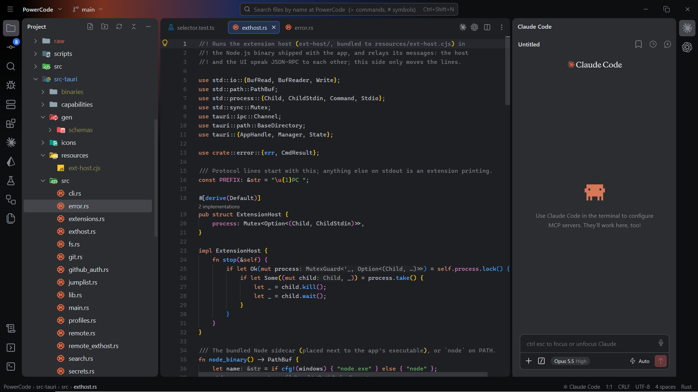

<p align="center">
  
</p>

<h1 align="center">PowerCode</h1>

<p align="center">
  A lightweight desktop IDE that runs VS Code extensions, with an IntelliJ-style interface.<br />
  Built with Tauri, Rust, React and Monaco.
</p>

<p align="center">
  <a href="https://github.com/mozinova/PowerCode/releases">Download</a> ·
  <a href="#building-from-source">Build from source</a> ·
  <a href="#contributing">Contributing</a> ·
  <a href="todo.md">API status</a>
</p>

<p align="center">
  
</p>

---

PowerCode is a code editor that aims to be small and fast like a native app while
keeping the extension ecosystem developers already use. It installs extensions
from [Open VSX](https://open-vsx.org) and runs them, JavaScript included, through
its own extension host: a bundled Node.js process that implements the `vscode`
API. The interface follows JetBrains' "New UI": tool windows on the sides, a
compact toolbar, a dark theme.

> **Status:** early and moving fast (0.1.x). Windows and Linux are the most
> used; the macOS builds are new and less tested. Expect rough edges, and please
> [report them](https://github.com/mozinova/PowerCode/issues).

## Features

- **VS Code extensions from Open VSX:** themes, icon themes, grammars, snippets,
  and extensions with code (language servers, debuggers, linters, AI assistants,
  webviews). The extensions VS Code ships built in (TypeScript, JSON, CSS, HTML,
  Markdown, Emmet, npm, the JavaScript debugger, ...) are installed on first start.
- **Language features** from language servers: completion, hover, go to
  definition, references, rename, code actions, formatting, inlay hints, semantic
  highlighting, call and type hierarchies, and more.
- **Editor:** Monaco with TextMate grammars, split editors, diff and compare views,
  auto save, and conflict detection when a file changes on disk under unsaved edits
  (an AI agent, `git`, another editor).
- **Git:** commit view, staging, branches, pull and push, a log graph. Extensions
  get the `vscode.git` API.
- **Terminal** (a real PTY), **debugging** through the Debug Adapter Protocol,
  **testing**, **tasks** (`tasks.json` and extensions' tasks), find in files.
- **AI:** an AI tool window that runs the assistant installed on your computer
  (Claude Code, Codex or OpenCode, found automatically) without its terminal
  interface, in Ask (read-only) or Agent mode, with one model picker for all of
  them; commit messages written from the diff.
- **Remote folders:** open folders over **SSH** or in **WSL**; the extension host
  then runs on the remote machine, next to the code.
- **Workspace Trust**, multiple windows, session restore, a Windows jump list with
  recent projects.

The `vscode` API is large: what is still missing is tracked in [todo.md](todo.md)
(notebooks, file decorations, `registerUriHandler`, ...). Members that do not exist
yet are filled with inert stand-ins, so extensions that touch them still activate.

## Download

Installers are on the [Releases](https://github.com/mozinova/PowerCode/releases) page:

- **Windows:** `.exe` (installer) or `.msi`
- **Linux:** `.deb`, `.rpm` or `.AppImage`
- **macOS:** `.dmg` for Apple Silicon or Intel. The app is not notarized by Apple
  yet: the first time macOS says it cannot verify it, open **System Settings →
  Privacy & Security** and choose **Open Anyway**. If macOS says the app "is
  damaged" (builds before 0.1.91), run
  `xattr -cr /Applications/PowerCode.app` once.

## Building from source

### Prerequisites

- [Rust](https://rustup.rs) (stable)
- [Bun](https://bun.sh) (the package manager and test runner)
- Node.js 20 or later (used by the build scripts)
- The [Tauri prerequisites](https://v2.tauri.app/start/prerequisites/) for your
  system. On Debian/Ubuntu:

  ```sh
  sudo apt install libwebkit2gtk-4.1-dev libayatana-appindicator3-dev librsvg2-dev libxdo-dev patchelf file
  ```

### Run and build

```sh
bun install
bun tauri dev      # run in development
bun tauri build    # build the installers for this system
```

Both download the Node.js binary that PowerCode bundles to run extensions
(`scripts/fetch-node.mjs`) and bundle the extension host before starting.

### Checks

```sh
bun x tsc --noEmit -p .          # UI types
bun x tsc -p ext-host            # extension host types
bun run test                     # TypeScript tests
bun run build                    # UI build
cd src-tauri && cargo test --lib # Rust tests
```

## How it is built

| Part | Where | What |
|---|---|---|
| UI | `src/` | React 19, TypeScript, Tailwind CSS v4, Monaco, xterm.js |
| Native side | `src-tauri/` | Tauri 2 and Rust: files, Git, terminals, search, Open VSX, SSH/WSL, encrypted secret storage |
| Extension host | `ext-host/` | A Node.js process implementing the `vscode` API, talking to the UI over JSON messages |

The UI and the native side talk through Tauri commands; the UI and the extension
host through JSON lines over stdio. [AGENTS.md](AGENTS.md) describes the layout,
conventions and checks in more detail.

## Contributing

Issues and pull requests are welcome.

- Look at the [open issues](https://github.com/mozinova/PowerCode/issues) and
  [todo.md](todo.md) for things to work on.
- Code, comments, UI text and commit messages are in English.
- Match the surrounding code, follow VS Code's behaviour for the `vscode` API, and
  run the checks above before opening a pull request.
- [AGENTS.md](AGENTS.md) is the project guide, written for AI coding agents and
  humans alike.

## License

[MIT](LICENSE) © Daniel Mucamba

PowerCode is an independent project. It is not affiliated with or endorsed by
Microsoft, Visual Studio Code, JetBrains or the Eclipse Foundation (Open VSX).
Extensions are third-party software under their own licenses.
